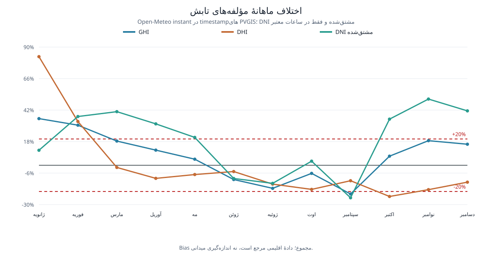
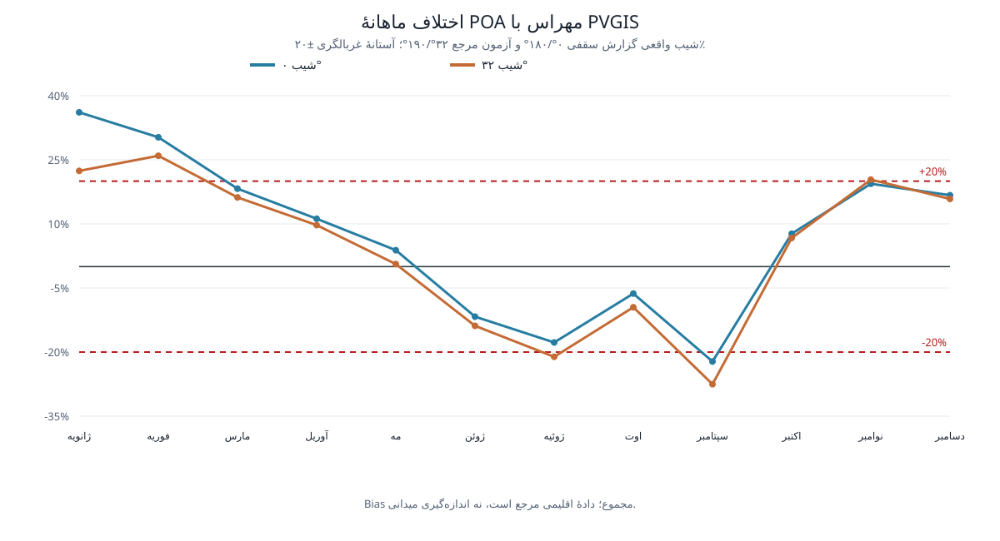
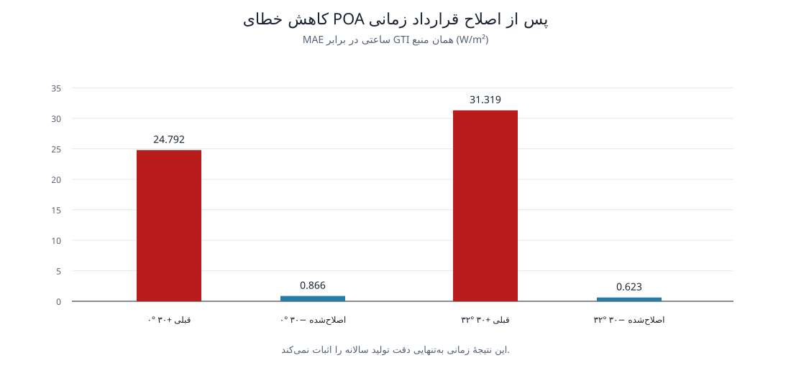
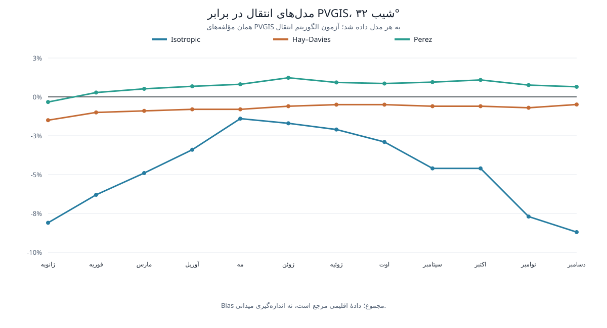

# Results catalogue

This page is a practical route into the evidence. Read the linked report before quoting any number.

## Solar energy

### Component-yield and POA comparison — 25 October 2026

- Report: [component-yield validation report](../validations/results/component_yield_2026-10-25/report.md)
- Machine-readable summary: [JSON summary](../validations/results/component_yield_2026-10-25/component_yield_summary.json)
- Acceptance matrix: [CSV](../validations/results/component_yield_2026-10-25/acceptance_matrix.csv)
- POA model comparison: [CSV](../validations/results/component_yield_2026-10-25/poa_model_comparison.csv)
- Annual-yield model comparison: [CSV](../validations/results/component_yield_2026-10-25/annual_yield_model_comparison.csv)
- Component-source comparison: [CSV](../validations/results/component_yield_2026-10-25/component_source_comparison.csv)
- Time alignment: [CSV](../validations/results/component_yield_2026-10-25/time_alignment.csv)

**Figures**

The report records both close numerical comparisons and remaining discrepancies. In particular, the annual-yield model comparison must be read with the differences in weather input and DC/AC boundaries; it is not a single pass/fail statement.

### Separate 32° / 190° case

- [Report](../validations/results/component_yield_2026-10-25_tilt32/report.md)
- [Monthly transposition comparison](../validations/results/component_yield_2026-10-25_tilt32/monthly_pvgis_transposition_bias_32deg.csv)

### Earlier POA run — 17 October 2026

- [Historical report](../validations/results/run_2026-10-17/report.md)
- [Summary JSON](../validations/results/run_2026-10-17/summary.json)
- [Monthly POA comparison figure](../validations/results/run_2026-10-17/monthly_poa_comparison.svg)
- [Monthly POA bias figure](../validations/results/run_2026-10-17/monthly_poa_bias.svg)

This is a historical snapshot and predates later work. It is retained for traceability.

## Airfoil-CAD and rotor engineering

- [Backend validation status](../Airfoil%20CAD/validation/airfoilcad_acceptance/VALIDATION_STATUS.md)
- [Acceptance test suite](../Airfoil%20CAD/validation/airfoilcad_acceptance/test_backend_acceptance.py)
- [Reference datasets and benchmark plan](../Airfoil%20CAD/validation/airfoilcad_acceptance/REFERENCE_DATASETS.md)
- [BEM model scope](../Airfoil%20CAD/BEM_VALIDATION.md)
- [Composite failure model review](../Airfoil%20CAD/COMPOSITE_FAILURE_VALIDATION.md)
- [Composite experimental reference rows](../Airfoil%20CAD/validation/airfoilcad_acceptance/composite_experimental_reference.csv)

The source status records 51 passing software checks on its dated snapshot. This is regression evidence, not a completed experimental benchmark.

## Weather data

- [Fixture documentation](../validation/weather/README.md)
- [Valid synthetic station sample](../validation/weather/station_sample_valid.csv)
- [Edge-case synthetic station sample](../validation/weather/station_sample_edge_cases.csv)

These files test data ingestion and quality-control behaviour. They are not measured weather observations.

## Site and financial evidence

- [Khalkhal site report](../validations/گزارش_اولیه_سایت_خلخال_2026-10-17.md)
- [Rooftop financial reconciliation](../validations/results/rooftop_financial_reconciliation_2026-10-25.csv)
- [Persian methodology and sources](../validations/روش‌شناسی_و_منابع.md)

## How to cite a result

Cite the specific report directory and its source commit, not only this catalogue. When quoting a metric, include its comparison period, reference, unit and whether it is a software check, numerical comparison or measured field result.
